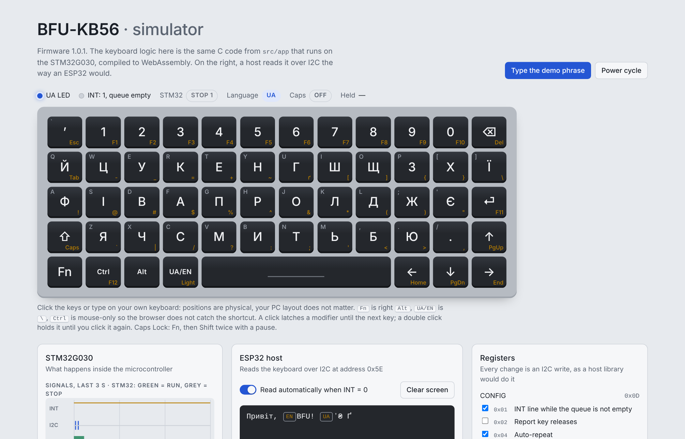

<div align="center">

# BFU-KB56

**A compact 56-key Ukrainian / English keyboard module for microcontrollers, over I2C.**

Plug it into an ESP32, Raspberry Pi or any I2C host and read ready-to-use UTF-8 characters — `й`, `ї`, `ґ`, `₴`
and `ʼ` included. No scan codes, no layout tables on the host.

[](LICENSE)
[](LICENSES/CC-BY-4.0.txt)




</div>

## Features

- **56 keys**, 5 × 12 matrix with a diode per key: full n-key rollover, no ghosting.
- **Two layouts out of the box:** Ukrainian ЙЦУКЕН (with ґ, є, і, ї, ʼ, ₴) and English QWERTY, plus an Fn layer
  with F1–F12, Esc, Del, Tab, navigation keys and symbols.
- **Host-friendly I2C protocol:** a 16-event FIFO, 8 bytes per event with final UTF-8 text and modifier state,
  an active-low INT line, and loss-free reads even if a transaction is cut short.
- **Typing comfort:** 5 ms debounce, configurable auto-repeat, Caps Lock, UA layout LED, optional backlight PWM.
- **Low power:** Stop mode when idle (≈ 12 µA), wake-up on any key or on the host addressing the keyboard.
- **Field-updatable:** one I2C command switches to the STM32 ROM bootloader, so firmware can be updated without a
  programmer. The bootloader lives in ROM, and SWD always remains as a fallback.
- **Bare-metal firmware:** plain C11 on CMSIS, no HAL, ≈ 7 KB of flash.
- **Thoroughly tested:** host-side unit tests, Renode emulation of the real firmware image and a browser
  simulator built from the same source.

## Quick start

Wire the keyboard to an ESP32 (see [docs/HARDWARE.md](docs/HARDWARE.md) for other hosts):

| Keyboard J1 | ESP32 |
|---|---|
| 1 GND | GND |
| 2 VCC | 3V3 |
| 3 SDA | GPIO 21 |
| 4 SCL | GPIO 22 |
| 5 INT | GPIO 4 |

Then read events with the standard Arduino `Wire` library:

```cpp
#include <Wire.h>

constexpr uint8_t KB_ADDR = 0x5E;
constexpr int KB_INT = 4;

uint8_t readReg(uint8_t reg) {
  Wire.beginTransmission(KB_ADDR);
  Wire.write(reg);
  Wire.endTransmission(false);
  Wire.requestFrom(KB_ADDR, (uint8_t)1);
  return Wire.read();
}

void setup() {
  Serial.begin(115200);
  Wire.begin(21, 22, 400000);
  pinMode(KB_INT, INPUT_PULLUP);
  uint8_t id = readReg(0x00);                    // 0x4B
  Serial.printf("BFU-KB56 found: ID 0x%02X\n", id);
}

void loop() {
  if (digitalRead(KB_INT) == HIGH) return;       // INT is low while events are waiting
  uint8_t n = readReg(0x04);                     // COUNT
  if (n == 0) return;

  Wire.beginTransmission(KB_ADDR);
  Wire.write(0x10);                              // FIFO
  Wire.endTransmission(false);
  if (Wire.requestFrom(KB_ADDR, (uint8_t)(n * 8)) != n * 8) return;   // all events in one read (ESP32: up to 16)

  for (uint8_t i = 0; i < n; i++) {
    uint8_t ev[8];
    for (uint8_t &b : ev) b = Wire.read();
    if (ev[0] != 1 && ev[0] != 3) continue;      // press or auto-repeat
    if (ev[4]) Serial.write(ev + 4, strnlen((const char *)ev + 4, 4));   // UTF-8 text
    else       Serial.printf("[special 0x%02X]", ev[5]);                 // arrows, F-keys, ...
  }
}
```

The full register map, event format and command set are in [docs/PROTOCOL.md](docs/PROTOCOL.md).
On AVR boards the `Wire` buffer is 32 bytes, so read at most 4 events at a time.

## Documentation

| Document | Contents |
|---|---|
| [docs/PROTOCOL.md](docs/PROTOCOL.md) | I2C protocol v1.0: transactions, registers, event format, FIFO, commands, key map |
| [docs/HARDWARE.md](docs/HARDWARE.md) | Connector pinout, solder jumpers, wiring, SWD programming, power figures |
| [docs/TESTING.md](docs/TESTING.md) | How the firmware is tested and how to run the tests |
| [CHANGELOG.md](CHANGELOG.md) | Release history |

## Building

Requirements: `arm-none-eabi-gcc` (Arm GNU Toolchain 10 or newer), CMake ≥ 3.20 and Make.

```sh
# Ubuntu / Debian
sudo apt install gcc-arm-none-eabi libnewlib-arm-none-eabi cmake make openocd
```

On Windows and macOS, install the [Arm GNU Toolchain](https://developer.arm.com/downloads/-/arm-gnu-toolchain-downloads),
CMake and (for flashing) [STM32CubeProgrammer](https://www.st.com/en/development-tools/stm32cubeprog.html),
and add them to `PATH`.

```sh
cmake --preset keyboard && cmake --build --preset keyboard   # BFU-KB56 board (STM32G030K6)
cmake --preset nucleo   && cmake --build --preset nucleo     # NUCLEO-G071RB test build
```

Output:

| Target | Files |
|---|---|
| Keyboard | `build/keyboard/bfu-kb56.{elf,hex,bin}` |
| NUCLEO-G071RB | `build/nucleo/bfu-kb56-nucleo-g071rb.{elf,hex,bin}` |

The CMake option `-DDEBUG_KEEP_SWD_IN_STOP=ON` keeps the debug port alive in Stop mode (handy for debugging, at
the cost of a higher sleep current).

## Flashing

Connect an ST-LINK to the SWD pads on the back of the board (pinout and NUCLEO-as-programmer instructions in
[docs/HARDWARE.md](docs/HARDWARE.md#swd-pads-j2--programming)), then either:

```sh
cmake --build --preset keyboard --target flash        # OpenOCD
```

or

```sh
STM32_Programmer_CLI -c port=SWD mode=UR -w build/keyboard/bfu-kb56.hex -v -rst
```

Both connect under reset, so the firmware's sleep mode does not interfere.

## Try it without the board

### NUCLEO-G071RB test build

The `nucleo` preset turns a NUCLEO-G071RB into a stand-in keyboard, so you can develop a host driver before you
have the hardware:

1. Keep the CN2 jumpers fitted (they are removed only when the NUCLEO is used as a programmer for the keyboard)
   and connect the NUCLEO over USB.
2. `cmake --build --preset nucleo --target flash`, or drag the `.bin` onto the `NOD_G071RB` drive.
3. Open the ST-LINK virtual COM port at **115200 8N1** to see a log line for every event.
4. Press the blue **B1 USER** button: the firmware "types" `Привіт, BFU! ʼ₴ Ґ⏎`, exercising Shift, layout
   switching, the apostrophe, the hryvnia sign, Fn + Shift and Enter. LED LD4 shows the UA layout.
5. Connect it to an ESP32 (all 3.3 V): D15 (PB8) → SCL, D14 (PB9) → SDA, D2 (PA10) → INT, GND → GND.
   Add 4.7 kΩ pull-ups to 3.3 V on SDA and SCL. The address is 0x5E.

### Browser simulator

[`tools/simulator`](tools/simulator) compiles the unmodified keyboard logic from `src/app` to WebAssembly and
runs it next to a model of an ESP32 host, with a live view of the FIFO, registers, INT line and I2C traffic.

```sh
cd tools/simulator
python3 build.py        # needs clang with the wasm32 target and wasm-ld (LLVM 15+)
node test_sim.cjs       # simulator self-test
```

The result is a single self-contained file that works offline, `tools/simulator/dist/bfu-kb56-simulator.html`.

## Testing

```sh
make -C tests                                                    # unit tests, ASan + UBSan
RENODE=/path/to/renode python3 tests/renode/run_renode_tests.py  # both firmware images in Renode
RENODE=/path/to/renode python3 tests/renode_full/run_full.py     # full-system emulation
```

The unit tests check all 56 keys in every layer against independently written expectations, plus modifiers,
Caps Lock, auto-repeat, FIFO overflow, interrupted FIFO reads, registers and commands. The full-system emulation
runs the real keyboard `.elf` on Renode with models of the STM32G030 peripherals, the key matrix (diodes and
contact bounce) and an ESP32 host on the I2C bus, including sleep and wake-up. Details in
[docs/TESTING.md](docs/TESTING.md).

## Repository layout

```
src/app/          hardware-independent keyboard logic (also built for the PC and WebAssembly)
  protocol.h        registers, event format, special codes
  app.c             debounce, modifiers, Caps Lock, auto-repeat, registers, FIFO reads
  keymap.c          UA / EN / Fn layout tables
  fifo.c utf8.c
src/hw/           STM32G0 drivers (CMSIS, no HAL)
  board.h           pin maps for both targets
  matrix.c          matrix scan and sleep preparation
  i2c_slave.c       interrupt-driven I2C1 slave and the INT line
  power.c           Stop 1 entry and exit
  boot.c            jump to the system bootloader
  led.c             UA LED and backlight PWM
  startup.c main.c
  demo.c uart_log.c   NUCLEO only: demo phrase and event log
ld/               linker scripts (G030K6, G071RB)
tests/            unit tests, Renode tests and full-system emulation
tools/simulator/  browser simulator (WebAssembly)
third_party/      Arm CMSIS Core and ST CMSIS Device G0
docs/             protocol, hardware guide, testing
```

## Roadmap

- Arduino / ESP-IDF host library
- I2C firmware flasher for ESP32 (ST AN4221)

## Contributing

Bug reports, protocol questions and pull requests are welcome. Please read [CONTRIBUTING.md](CONTRIBUTING.md)
first.

## License

| Part | License |
|---|---|
| Firmware, tests and tools | [Apache License 2.0](LICENSE) |
| Documentation in `docs/`, including the protocol specification | [CC BY 4.0](LICENSES/CC-BY-4.0.txt) |
| `third_party/` (Arm CMSIS, ST CMSIS Device G0) | Apache License 2.0, see the license files in each directory |

Copyright © 2026 BFU Electronics LTD. See [NOTICE](NOTICE).

The BFU-KB56 hardware design (schematic, PCB layout and bill of materials) is proprietary and not covered by
these licenses. "BFU", "BFU Electronics" and "BFU-KB56" are trademarks of BFU Electronics LTD; see [TRADEMARKS.md](TRADEMARKS.md)
for how you may and may not use them.

## Contact

BFU Electronics LTD · [contact@bfu-electronics.com](mailto:contact@bfu-electronics.com)

For bugs and questions about the firmware or the protocol, please open an issue in this repository.
