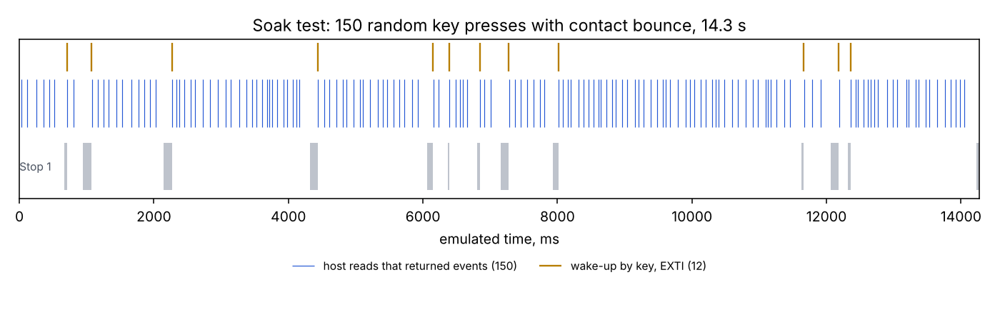

<!-- SPDX-FileCopyrightText: 2026 BFU Electronics LTD -->
<!-- SPDX-License-Identifier: CC-BY-4.0 -->

# Testing

The firmware is tested on three levels. All of them run in CI on every pull request and every push to `main`.

| Level | What runs | Where | Checks |
|---|---|---|---|
| Unit tests | `src/app` logic, compiled for the PC with AddressSanitizer and UBSan | `tests/test_app.c` | 810 |
| Firmware images | Both `.elf` files on an emulated Cortex-M0+ | `tests/renode/` | 18 |
| Full-system emulation | The keyboard `.elf` with STM32G030 peripheral models, the key matrix and an I2C host | `tests/renode_full/` | 134 in 27 scenarios |

The browser simulator (`tools/simulator`) has its own self-test (`node test_sim.cjs`, 31 checks).

## Running the tests

Unit tests need only a C compiler:

```sh
make -C tests
```

The emulation tests need [Renode](https://renode.io) 1.15 or newer, a build of both presets and, for the
full-system run, `arm-none-eabi-gcc` (it assembles a small ROM stub):

```sh
cmake --preset keyboard && cmake --build --preset keyboard
cmake --preset nucleo   && cmake --build --preset nucleo
export RENODE=/path/to/renode

python3 tests/renode/run_renode_tests.py         # both images
python3 tests/renode_full/run_full.py            # all full-system scenarios (about 15–20 min)
python3 tests/renode_full/run_full.py soak       # a single scenario
python3 tests/renode_full/plot_timeline.py       # timeline plot of the soak run (needs matplotlib)
python3 tests/renode_full/profile_tick.py        # CPU time per 1 ms scan tick, from an emulated run
```

`run_full.py` prints PASS/FAIL per check and writes logs and a JSON summary to `build/renode_full/`.

## Unit tests

`tests/test_app.c` drives the hardware-independent core through the same API the drivers use. It checks:

- every key in every layer (UA, UA + Shift, EN, EN + Shift, Fn) against expected characters written
  independently of the layout tables, plus the special codes;
- modifiers, Caps Lock (Fn + Shift), layout switching, the apostrophe option;
- debounce, auto-repeat timing and which keys repeat;
- the FIFO: overflow, the `STATUS` overflow flag, reads cut in the middle of an event;
- all registers, write masking, pointer auto-increment and the commands, including the confirmation byte;
- the UTF-8 encoder;
- the event examples in [PROTOCOL.md](PROTOCOL.md), byte for byte.

## Full-system emulation

The real keyboard firmware image runs unmodified on Renode's Cortex-M0 core (16 MIPS, about one instruction per
clock at 16 MHz). The STM32G030 peripherals the firmware uses are modelled after the reference manual (RM0454) in
`tests/renode_full/models/UaKbModels.cs`:

- **GPIO with pin electrics:** push-pull and open-drain drivers, external drivers, internal and external pull-ups.
  The model reports driver conflicts, reads of a floating input and accesses to an unclocked port.
- **EXTI, PWR and RCC:** falling-edge wake-up lines, Stop 0/1 entry on WFI + SLEEPDEEP + LPMS, clock gates.
- **I2C1 slave, byte by byte:** clock stretching, TXDR preload, NACK, STOP, repeated START and wake-up from Stop
  on address match (WUPEN).
- **An I2C master playing the ESP32 host:** clocks bytes at 100 or 400 kHz in virtual time and waits while the
  slave stretches SCL.
- **The 5 × 12 key matrix:** a diode per key, contact bounce and a column recovery time.
- **A ROM stub** at 0x1FFF0000 in place of the ST system bootloader, which cannot be emulated.

Every scenario also requires that the models raised no complaint and that the host completed all of its
operations.

| Scenario | What is verified |
|---|---|
| `identity` | Registers 0x00–0x0A over I2C; pin modes: INT open-drain, SCL/SDA AF6 open-drain, rows push-pull, columns input with pull-up |
| `typing` | 3 ms of bounce on make and break gives exactly one event; INT falls and is released |
| `ghosting` | Three keys at the corners of a rectangle report only those three keys |
| `layers` | UA, EN, Fn + Shift and F-keys through the real matrix scan |
| `fifo` | A read cut after byte 5 removes nothing; 16 bytes return the two oldest events; then zeros |
| `fifo_edges` | 7-byte reads remove nothing, 15-byte reads exactly one event, the half-read event comes back whole |
| `overflow` | 18 unread presses: `COUNT` 16, `STATUS` 0x81, the flag is cleared by the read |
| `status_preload` | A one-byte read of 0x02 must not clear the overflow flag (regression test, fixed in 1.0.1) |
| `isr:40000` | Interrupt service delayed by 40 µs: register reads still start at the right register (regression test, fixed in 1.0.1) |
| `settings` | Key releases, LED modes, backlight PWM, no sleep while the backlight is on |
| `repeat` | Auto-repeat timing |
| `stop_key` | Stop 1 after ~100 ms idle; all rows low in Stop; a key wakes the MCU via EXTI and its event is not lost |
| `stop_i2c` | The host transaction itself wakes the MCU; SCL is stretched for the wake-up; the MCU sleeps again |
| `sleep_pending` | The MCU sleeps with unread events, INT stays low, a host read wakes it and gets the event |
| `reset`, `bootloader` | Commands need the 0xA5 confirmation; the bootloader jump sets the ROM stack pointer and memory remap, and 0x5E stops answering |
| `jp3` | With the address jumper closed 0x5E NACKs and 0x5D answers |
| `speeds` | Four events per read at 100 and 400 kHz with short clock stretching |
| `soak` | 150 random presses with bounce and random pauses: the host receives every event in order |
| `settle:1920`, `ghost:25000` | The matrix scan tolerates the board's column recovery time; a deliberately slow column produces ghost keys |
| `*@10` | Bus, I2C wake-up and FIFO edge cases repeated on a slower 10 MIPS core |



### Negative controls

To make "the models raised no complaint" meaningful, each model check was broken on purpose and shown to fire:

| What is broken | What the model reports |
|---|---|
| WUPEN cleared before sleep | "address match in Stop but WUPEN=0: no ACK", the host gets a NACK |
| SCL switched to push-pull | "I2C pin misconfigured", the host gets a NACK |
| The pull-up on column PA1 removed | "PA1 read while floating" |

### Limits

Renode counts instructions, not clock cycles, so timing is approximate (the 10 MIPS runs cover a slower core).
Analog behaviour of the pins and of the bus (edge rates, noise) is outside the scope of these tests and is
verified on real hardware.
